# Rota ([@therotaapp](https://www.instagram.com/therotaapp/))

<p align="center">
  <a href="https://www.instagram.com/therotaapp/">
    
  </a>
  <a href="https://therotaapp.com">
    
  </a>
  
  
</p>

<p align="center">
  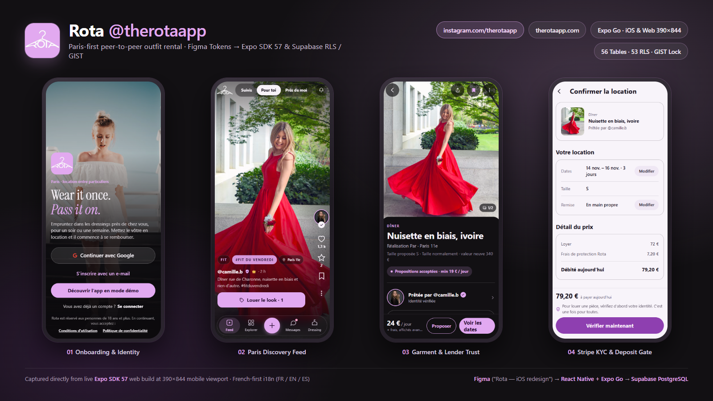
</p>

<p align="center">
  
  &nbsp;&nbsp;&nbsp;
  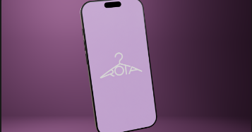
</p>

Rota is a Paris-first, peer-to-peer **outfit rental** app ([therotaapp.com](https://therotaapp.com) · Instagram [@therotaapp](https://www.instagram.com/therotaapp/)). People lend pieces they already own and rent them for a few days. It is **not** a resale marketplace and **not** a social network: posts, stories, boards, and follows exist solely to showcase garments and lead directly to a booking.

- **Official links:** Web waitlist at [therotaapp.com](https://therotaapp.com) · Instagram community & drops at [instagram.com/therotaapp](https://www.instagram.com/therotaapp/) (`@therotaapp`).

- **Languages & locale:** French-first product copy with English and Spanish in-app (`mobile/src/i18n/`).
- **Public-by-design marketplace:** Accounts and live stories are public (`034_public_accounts.sql`); minimum age is **18+** (`adult_confirmed_at`); safety controls (block, mute, restrict, message requests, hidden words, 30-day bin, export, account deletion) remain enforced in Postgres.
- **Handover model:** Free public meetup in Paris (`Rencontre à Paris — Offert`) is the default; tracked parcel shipping (`Rota Delivery`) stays gated behind `policy_config.flag_rota_delivery = false` until carrier labels and webhook tracking are connected ([docs/DELIVERY.md](docs/DELIVERY.md)).

---

## Live Mobile Walkthrough & Verified `390x844` App Screens

Every mobile screen below was captured directly from the **Expo SDK 57 web build** (`mobile/`, `npx expo export --platform web`, demo catalog mode) at exact **`390×844`** mobile viewport dimensions (`deviceScaleFactor: 1`) using headless Chrome via Playwright, alongside a live interactive walkthrough recording.

<p align="center">
  
</p>

- Full walkthrough video: [MP4 (1.53 MB, 390×844 H.264)](docs/proof/rota-mobile-walkthrough.mp4) · [WebM (4.26 MB, 390×844 VP9)](docs/proof/rota-mobile-walkthrough.webm) · [GIF preview (3.07 MB)](docs/proof/rota-mobile-walkthrough.gif)
- All `phone-*.png` files are verified **`390×844`** (`docs/proof/phone-*.png`). Notice in Checkout (`phone-checkout.png` / `phone-checkout-light.png`) how identity verification (`Vérifier maintenant`) gates payment before Stripe checkout, and how `Rencontre à Paris — Offert` is selected by default on Dates (`phone-dates.png`).

| Welcome (`390×844`) | Feed — *Pour toi* (`390×844`) | Piece Detail (`390×844`) |
|---|---|---|
|  | 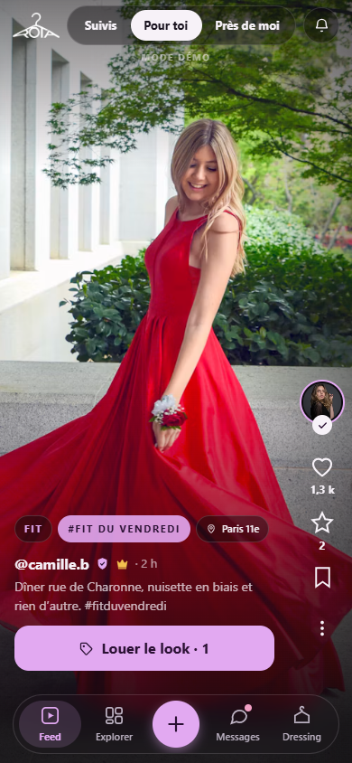 | 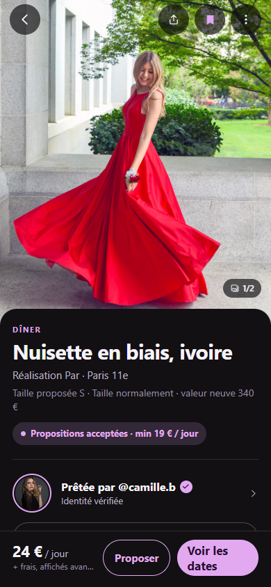 |
| **Apple / Google / Email + Demo entry.** 18+ notice, lavender hanger icon, Instrument Serif brand display. | **Editorial fit feed + Liquid Glass bar.** *Louer le look* tag, ~550 m Paris area chip, verified badge. | **Listing detail.** Gallery, brand, replacement value, negotiated offers, *Voir les dates* CTA. |

| Dates & Handover (`390×844`) | Checkout — Dark (`390×844`) | Checkout — Light (`390×844`) |
|---|---|---|
| 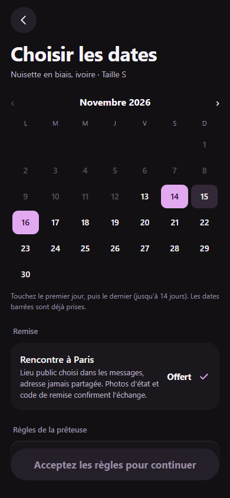 | 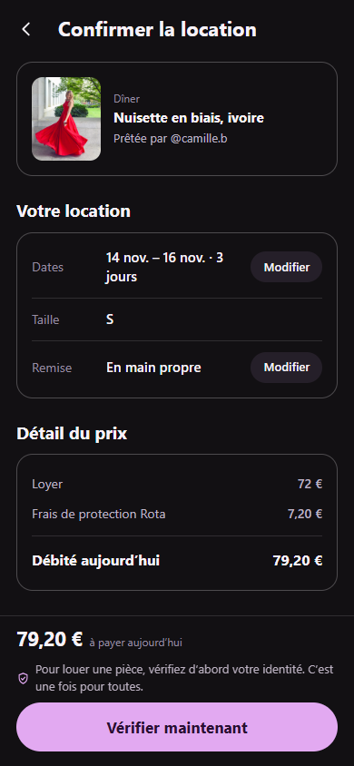 | 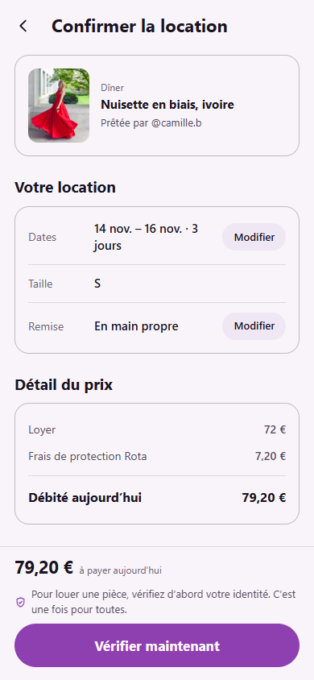 |
| **Calendar & handover choice.** Month picker with booked-day lockouts, *Rencontre à Paris — Offert*, lender rules gate. | **Itemized pre-payment disclosure.** Rent, 10% protection fee, total charged, Stripe Identity gate. | **High-contrast light theme.** `#F8F4FA` ground with `#8E3FB0` deep lavender CTA for WCAG contrast. |

| List a Piece (`390×844`) | Messages (`390×844`) | Settings (`390×844`) |
|---|---|---|
| 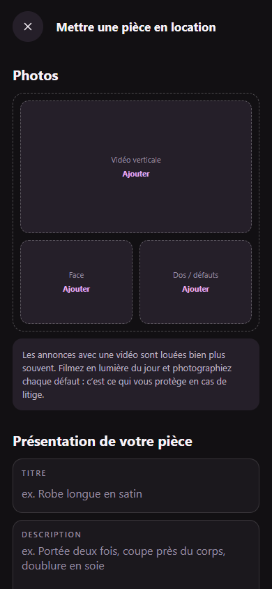 | 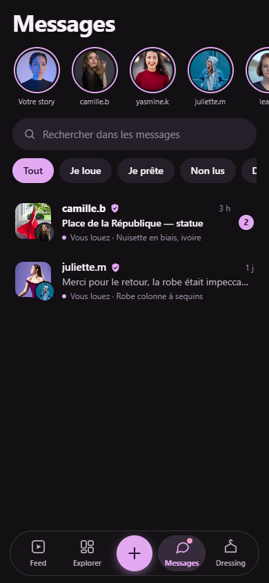 | 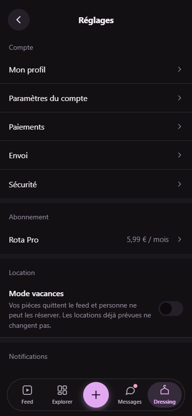 |
| **Listing creation.** Vertical video, front, back/defects slots, Paris daylight protection guidance. | **Rental-scoped inbox.** Stories tray, *Je loue / Je prête / Non lus* filters, public Paris meeting points. | **Account & safety controls.** Profile, payments, Rota Pro, vacation mode, privacy, DSA decisions, legal. |

Desktop prototype stage captures (`src/` Vite build at `2880×2208` / `2880×2200` Retina): [docs/proof/desktop-onboarding.png](docs/proof/desktop-onboarding.png) · [docs/proof/desktop-checkout-light.png](docs/proof/desktop-checkout-light.png). Earlier Figma/design exports live in [design/social-screens/](design/social-screens/).

---

## Architecture & Database Design

**Core architectural invariant:** *The phone is an untrusted client. Postgres decides prices, availability, liability ceilings, try-on budgets, and payouts.* Edge Functions only bridge external APIs (Stripe, Claude, Decart, Resend, SIRET registry) and write verified outcomes back to Postgres.

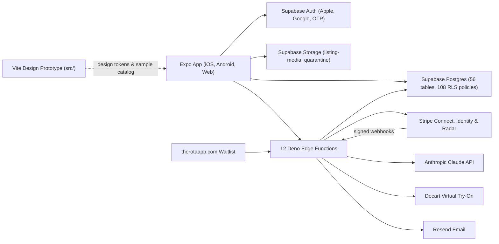


### Database & Trust Guarantees (`supabase/`)

Across `supabase/schema.sql`, **53** SQL migrations (`001`–`038`), and **11** SQL privacy verification scripts:
- **56** `CREATE TABLE` definitions, **53** `ENABLE ROW LEVEL SECURITY` calls, **108** `CREATE POLICY` rules, and **207** `SECURITY DEFINER` RPCs/triggers.
- **Zero double-booking at the database level (`004_payments_and_rental_ops.sql`):** Postgres `btree_gist` extension + `rentals_no_double_booking` constraint:
  ```sql
  alter table public.rentals
    add constraint rentals_no_double_booking
    exclude using gist (listing_id with =, blocked_during with &&)
    where (status not in ('cancelled', 'returned', 'closed'));
  ```
  `rentals_validate_dates()` computes `blocked_during` as `[start_date, end_date + 1 + turnaround_days)` (1 turnaround day for return & cleaning) and holds unpaid bookings for `payment_window_minutes` (30 minutes).
- **Stripe Connect, Identity & Idempotent Outbox (`payments`, `stripe-webhook`, `worker`):**
  - `payment_accounts` is strictly separated from public `profiles` (`004`).
  - Lender onboarding provisions French (`FR`) Stripe Connect accounts with clothing-rental MCC `7296` and `controller: { fees: { payer: 'application' }, losses: { payments: 'application' }, stripe_dashboard: { type: 'express' } }`.
  - Stripe Identity (government ID + matching selfie) gates renting and listing (`checkout.tsx`, `ListPiece.tsx`, `Verify.tsx`).
  - `stripe-webhook` verifies signatures against both `STRIPE_WEBHOOK_SECRET` and `STRIPE_CONNECT_WEBHOOK_SECRET`, deduplicates via `record_stripe_event`, and flags disputes/Radar early fraud warnings (`flagged = 'dispute' | 'fraud_warning'`).
  - Payouts (`transfer_payout`), claims (`charge_claim`), and refunds (`refund_rental`) are queued in `payment_jobs` by Postgres and executed by `worker` using deterministic idempotency keys.
- **AI Guardrails & Server Budgets:**
  - `moderate-listings`: runs optional abuse-hash stub → Mux server video stills → Claude vision description; deterministic `policy.ts` assigns `public`, `limited`, or `blocked` and quarantines unsafe assets to `moderation-quarantine`.
  - `outfit-planner`: Rota Pro only (`is_pro`), capped at 30 plans/day (`bump_ai_usage`), and strips any listing ID not present in the real database catalog sent in the prompt.
  - `tryon-token`: `tryon_token_allowed` (`036_tryon_server_budget.sql`) uses `pg_advisory_xact_lock` + hourly/daily ceilings before minting a 10-minute Decart client token restricted to `lucy-vton-3.5` and `lucy-image-2` (3-minute max realtime session).

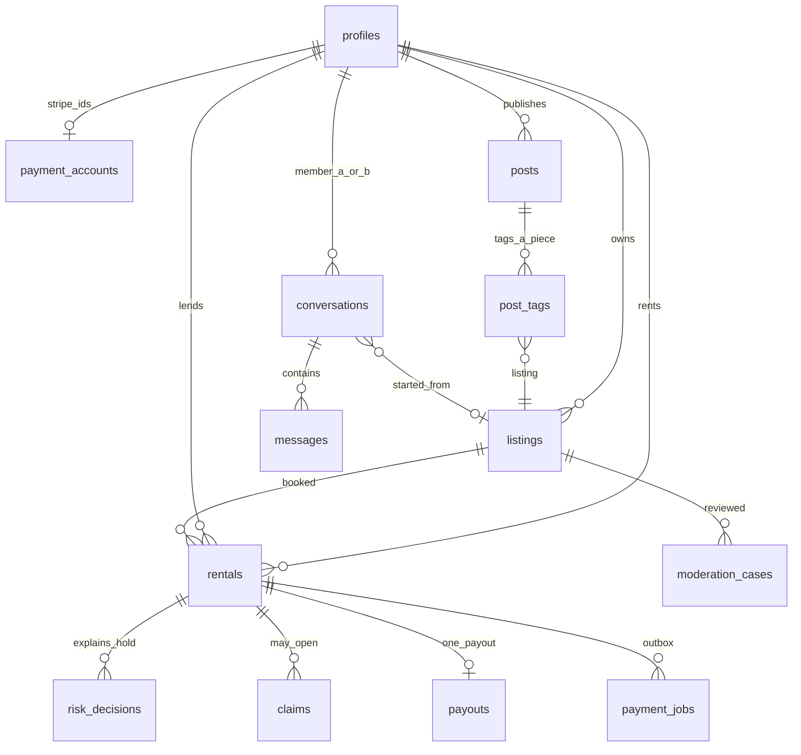


Full schema inventory, 12 Edge Functions, and column-level decisions are documented in [docs/ARCHITECTURE.md](docs/ARCHITECTURE.md).

---

## Tools, Skills, Figma, Expo Go & Engineering Stack

### Design & Prototyping Workflow (`Figma → Vite → Expo Go`)
- **Figma Design System (`"Rota — iOS redesign" → Tokens`):** Defined typography roles (`SF Pro` / `Roboto` system UI text + `Instrument Serif` reserved for brand headlines), brand lavender `#E2A9F1` (`#8E3FB0` on light surfaces for WCAG contrast), pill radii (`999`), `28 pt` modal sheets, floating Liquid Glass 4-tab bar (`expo-blur` with Reduce Transparency fallback), and hanger mark (`design/brand/`). Earlier design exports are archived in `design/social-screens/` (`00-overview.jpg` – `16-detail-tryon.jpg`).
- **Clickable Web Prototype (`src/`):** Vite `6.4.3` + React `18.3.1` + TypeScript `5.6.3` single-page stage (`36` files, `8,118` lines) used for rapid screen iteration and desktop review.
- **iOS Mobile Development & Testing (`mobile/` + Expo Go + EAS):** Expo SDK `57.0.24` + React Native `0.86.3` + React `19.2.3` + TypeScript `6.0.3` (`82` files, `27,780` lines across `26` screens). Tested on physical iPhones via **Expo Go** over LAN / `--tunnel` ([docs/TEST_ON_PHONE.md](docs/TEST_ON_PHONE.md)), previewed in browser via `expo start --web` with `mobile/metro.config.js` web shims (`web-shims/stripe-react-native.tsx`), and configured for TestFlight / Play internal builds via `mobile/eas.json` (`development`, `preview`, `production` profiles; bundle ID `com.rota.app`).

### Installed Packages (Verified from Lockfiles)

| Layer | Key Packages & Versions |
|---|---|
| **Mobile App (`mobile/`)** | `expo` `~57.0.24`, `react` `19.2.3`, `react-native` `0.86.3`, `react-native-web` `^0.21.2`, `typescript` `~6.0.3`, `@supabase/supabase-js` `^2.116.0`, `@stripe/stripe-react-native` `0.64.0`, `@decartai/sdk` `^0.2.3`, `@expo-google-fonts/instrument-serif`, `@expo-google-fonts/archivo`, `expo-apple-authentication`, `expo-blur`, `expo-camera`, `expo-image`, `expo-image-manipulator`, `expo-location`, `expo-notifications`, `expo-video`, `react-native-maps` `1.27.2`, `react-native-svg` `15.15.4` |
| **Design Prototype (`src/`)** | `react` / `react-dom` `^18.3.1`, `vite` `^6.0.7` (`6.4.3` installed), `@vitejs/plugin-react` `^4.3.4`, `typescript` `~5.6.3` |
| **Backend (`supabase/functions/`)** | Deno Edge Runtime (`verify_jwt = false` in `supabase/config.toml`), `npm:stripe@22`, `npm:@supabase/supabase-js@2`, `npm:@anthropic-ai/sdk`, `npm:@decartai/sdk@0.2`, Resend HTTPS API, optional Mux video stills, French gov SIRET lookup (`recherche-entreprises.api.gouv.fr`), RevenueCat (`iap-webhook`) |

### Agent Skills, Compliance & Verification Tooling in Repo
- **Repo Agent Skills (`.agents/skills/` & `skills-lock.json`):** `ios-design` (`uizze.sh`), `ui-taste` (`uizze.sh`), and `find-skills` (`vercel-labs/skills`), plus `.claude/launch.json` local dev server presets (`rota` on port `5173`, `rota-mobile-web` on port `8093`).
- **App Store / Play Compliance Audit (`docs/LAUNCH_PLAN.md`):** Audited against `mjmirza/app-store-compliance` (`expo prebuild --platform android`), tracking iOS Privacy Manifests (`NSPrivacyAccessedAPITypes`), `allowBackup: false`, `SYSTEM_ALERT_WINDOW` removal, Universal Links / App Links (`therotaapp.com/p/*`, `/u/*`), and EU AI Act Art. 50 / DSA trader disclosures.
- **Verification & Visual Proof Toolchain:** `tsc -b --noEmit` (root), `tsc --noEmit` & `node scripts/check-purchase-price.mjs` (`mobile/`), Playwright + headless Chrome (`390×844` captures & video), FFmpeg (MP4/GIF encoding), Mermaid 11, and Python Matplotlib (`docs/proof/engineering-metrics.png`).

---

## Run It Locally

Requires **Node.js 22+**.

**1. Expo Mobile App (`mobile/`):**
```bash
cd mobile
npm ci
npm run typecheck    # tsc --noEmit
npm run check:price  # 10 assertions on parsePurchasePrice
npm run web          # Expo web preview (demo mode if mobile/.env is unset)
npm run start        # Expo Go on iOS/Android (see docs/TEST_ON_PHONE.md)
```
Copy `mobile/.env.example` to `mobile/.env` for live Supabase auth/data; leave `EXPO_PUBLIC_STRIPE_PUBLISHABLE_KEY` empty to keep payments off, or omit `.env` entirely to use the built-in in-memory Paris demo catalog.

**2. Vite Design Prototype (repo root):**
```bash
npm ci
npm run typecheck    # tsc -b --noEmit
npm run build        # production bundle -> dist/
npm run dev          # Vite dev stage
```

**3. Supabase Database & Edge Functions:**
Step-by-step setup (migrations order, Vault secrets, `pg_cron`, Stripe webhooks, secrets safety) is in [docs/BACKEND_SETUP.md](docs/BACKEND_SETUP.md). SQL privacy verification scripts live in `supabase/tests/privacy/` (`_prelude.sql` + 10 privacy specs).

---

## Verified Checks

All TypeScript checks, price parsing assertions, production build, and `390×844` Expo web captures were run cleanly on this branch (see [docs/PROOF.md](docs/PROOF.md) and [docs/PROOF_OF_WORK.md](docs/PROOF_OF_WORK.md) for exact command outputs and limitations):

| Check | Scope | Result |
|---|---|---|
| `npm run typecheck` (root) | Vite prototype (`src/`) | **PASS** (exit 0) |
| `npm run build` (root) | Vite 6.4.3 production build | **PASS** (exit 0, 60 modules, 332.07 kB JS) |
| `npm run typecheck` (`mobile/`) | Expo SDK 57 app (`mobile/src/`) | **PASS** (exit 0) |
| `npm run check:price` (`mobile/`) | `parsePurchasePrice` unit assertions | **PASS** (`10 cases pass`, exit 0) |
| `npx expo export --platform web` (`mobile/`) | Expo web Metro bundle | **PASS** (911 modules bundled, exit 0) |
| Playwright `390×844` capture & walkthrough | 9 screens + MP4/WebM/GIF | **PASS** (all 9 PNGs verified `390×844`) |
| ESLint / Biome | Repo-wide | Not configured (`no config`) |
| `supabase/tests/privacy/*.sql` | Postgres RLS specs | Not executed here (no local Postgres / Supabase CLI session) |

---

## Where to Read Next

| Doc | Contents |
|---|---|
| [docs/CASE_STUDY.md](docs/CASE_STUDY.md) | Deep-dive engineering case study (Figma → Expo Go, RLS/GIST, Stripe Connect, AI guardrails) |
| [docs/ARCHITECTURE.md](docs/ARCHITECTURE.md) | 56 tables, 12 Edge Functions, system & ER diagrams |
| [docs/PROOF.md](docs/PROOF.md) & [docs/PROOF_OF_WORK.md](docs/PROOF_OF_WORK.md) | Exact verified command logs, screenshot dimensions, media inventory, codebase counts |
| [docs/BACKEND_SETUP.md](docs/BACKEND_SETUP.md) | Supabase migrations, Edge Function secrets, Stripe webhooks, `pg_cron` |
| [docs/TEST_ON_PHONE.md](docs/TEST_ON_PHONE.md) | Testing on physical iPhone via Expo Go |
| [docs/BUILD.md](docs/BUILD.md) & [docs/LAUNCH_PLAN.md](docs/LAUNCH_PLAN.md) | EAS builds & App Store / Play Store compliance audit |
| [docs/DELIVERY.md](docs/DELIVERY.md) & [docs/IAP.md](docs/IAP.md) | Hand-to-hand Paris handover, Rota Delivery gate, RevenueCat IAP |
| [docs/legal/](docs/legal/) | Counsel drafts (not yet reviewed/published) |

## Repository Layout

```text
mobile/       Expo SDK 57 app (82 TS/TSX files, 26 screens, web shims, EAS config)
supabase/     schema.sql, 53 SQL migrations, 12 Deno Edge Functions, 11 SQL privacy scripts
src/          Vite + React 18 design prototype (36 TS/TSX files)
design/       brand marks, earlier screen exports (design/social-screens/)
website/      static waitlist & DSA report pages (therotaapp.com)
docs/         architecture, case study, proof of work, launch/legal/setup guides
```

## License

Private. All rights reserved.
