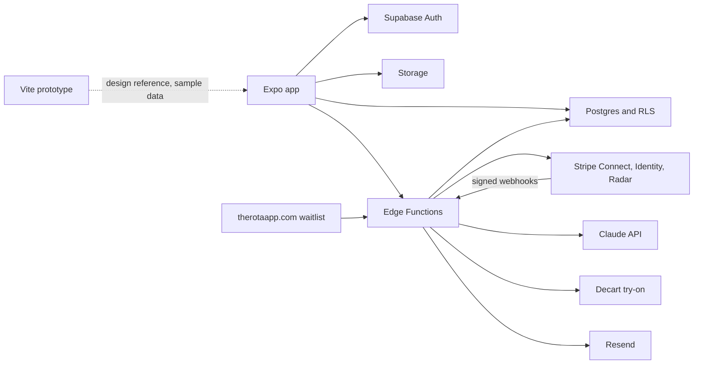
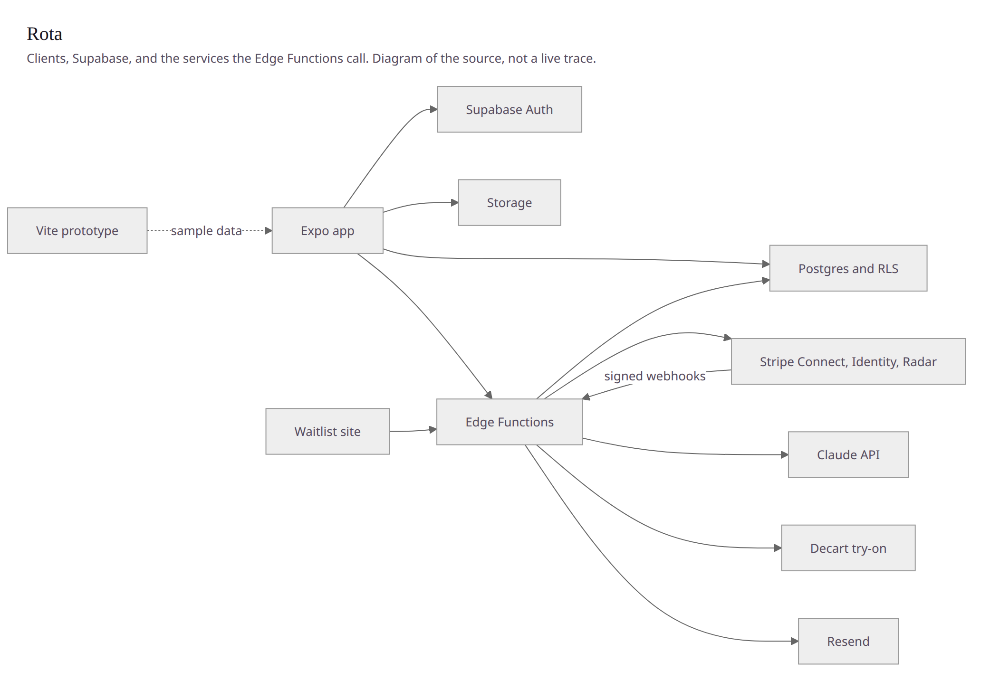
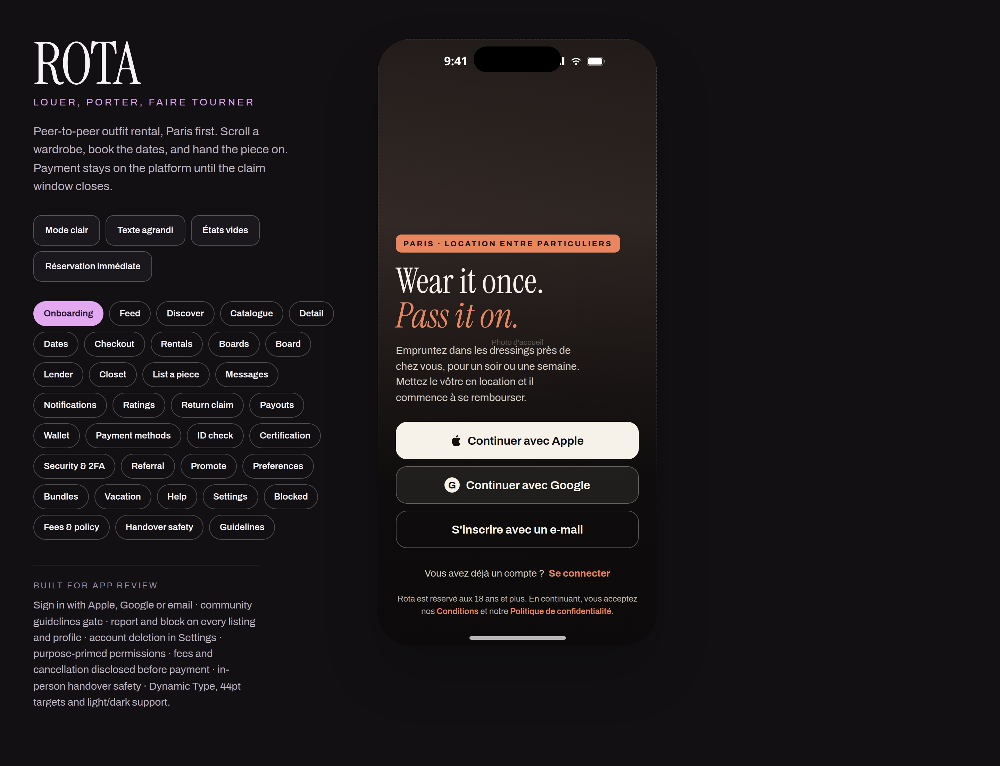

# Rota

Rota is a Paris-first, peer-to-peer **outfit rental** app. People lend clothes they already own and rent them for a few days. It is not a resale marketplace, and it is not a social network: posts, stories and follows exist to show a piece and lead to a booking.

The product copy is French first, with English and Spanish in the app. Accounts are public. Minimum age in the app and in the legal drafts is 18. Block, report, message requests and mute stay in place.

This repository holds the Expo app, the Supabase schema and Edge Functions, a Vite design prototype, and the launch notes. It is private.

## Architecture

The phone never decides a price, a verdict or a payout. Postgres (row-level security, constraints, and `security definer` functions) decides. Edge Functions carry the call to Stripe, Claude or Decart, then write the result back.



Rendered from that diagram with Mermaid 11 in headless Chrome on 13 November 2026. It is a map of the source, not a live trace.



The table diagram, the 12 Edge Functions, and the 56 tables are in [docs/ARCHITECTURE.md](docs/ARCHITECTURE.md).

Money path, as written in `supabase/functions/payments`, `stripe-webhook` and `worker`:

1. The renter pays a `PaymentIntent` in euros. The amount is the rental total already stored on the row.
2. Stripe webhooks confirm the payment. The function checks the signature, then calls `stripe_rental_payment_event`.
3. A lender payout is a row in `payment_jobs` (`transfer_payout`), created by the database after the return and the claim window. The worker executes that job with the job's idempotency key. It does not choose the amount.
4. Lender onboarding is a Stripe Connect account, country `FR`, clothing-rental MCC `7296`, with Rota as the fees and losses payer. Identity is a Stripe Identity document session with a matching selfie.

Listing review, as written in `supabase/functions/moderate-listings`: the model describes the images; `policy.ts` turns that description into `public`, `limited` or `blocked`. A caller cannot pick the verdict. Unsafe media can be moved to a quarantine bucket.

Virtual try-on, as written in `tryon-token`: the Decart secret stays in Supabase. A signed-in member receives a token that lasts 10 minutes, allows only `lucy-vton-3.5` and `lucy-image-2`, and caps a live session at 3 minutes. Migration 036 decides whether that token is allowed.

## Key flows

These frames are the Vite prototype after `npm run build`, opened with `vite preview` on 13 November 2026. The data on screen is the local sample catalog. They are not a signed-in session against Supabase, and the checkout chips (PayPal, an in-app wallet) are design-time choices. The app that charges cards uses Stripe only. PayPal outside that flow is treated as an off-platform payment in the app copy and in the message filter.

| | |
|---|---|
|  |  |
| Welcome. Apple, Google, or email. The line under the buttons says 18+. | Feed, "Pour vous". A piece, a daily price, and a path to book. |
|  |  |
| Piece detail. Offer or dates. Sample lender. | Dates, then handover. The prototype still shows a prepaid round trip. Server-side, `flag_rota_delivery` refuses `ship` until labels exist. |
|  |  |
| Checkout in the prototype, dark. | Listing a piece: vertical video, front, back. |
|  |  |
| Same checkout with the light theme toggle. | Messages in the prototype. The app's inbox is one conversation per pair of members. |

The stage the prototype actually serves, with every screen one click away:



Settings, from the same session: [docs/proof/phone-settings.png](docs/proof/phone-settings.png).

Earlier design exports (not re-rendered for this page) live in `design/social-screens/`.

## Tech stack

Versions below are the ones `npm ls --depth=0` printed after `npm ci` on 13 November 2026, from the lockfiles. Node was v22.23.4 and npm 10.9.9.

### App — `mobile/`

| Package | Installed |
|---|---|
| expo | 57.0.24 |
| react / react-dom | 19.2.3 |
| react-native | 0.86.3 |
| react-native-web | 0.21.2 |
| typescript | 6.0.3 |
| @supabase/supabase-js | 2.116.0 |
| @stripe/stripe-react-native | 0.64.0 |
| @decartai/sdk | 0.2.3 |
| expo-camera, expo-location, expo-notifications, expo-video, expo-image, expo-blur | 57.0.x (see `mobile/package.json`) |
| react-native-maps | 1.27.2 |

`mobile/eas.json` asks for EAS CLI `>= 12.0.0`. Bundle id `com.rota.app`.

### Design prototype — repository root

| Package | Installed |
|---|---|
| react / react-dom | 18.3.1 |
| vite | 6.4.3 |
| typescript | 5.6.3 |
| @vitejs/plugin-react | 4.7.0 |

### Server — `supabase/`

Deno Edge Functions, configured in `supabase/config.toml` with `verify_jwt = false` because each function checks its own caller (member token, Stripe signature, RevenueCat secret, or cron). Imports named in the function source:

| Import | Where |
|---|---|
| `npm:stripe@22` | payments, stripe-webhook, worker |
| `npm:@supabase/supabase-js@2` | shared client |
| `npm:@anthropic-ai/sdk` (no version pin in the import) | moderate-listings, outfit-planner |
| `npm:@decartai/sdk@0.2` | tryon-token |

Resend is called over HTTPS from `worker` and `send-welcome`. Mux is optional, for server-side video stills. SIRET checks call `recherche-entreprises.api.gouv.fr`. Store purchases are recorded from RevenueCat in `iap-webhook`.

There is no ESLint or Biome config in this repository.

## Run it locally

Requires Node.js 22 or newer.

**Clickable prototype** (no keys):

```bash
npm ci
npm run dev
```

`npm run build` writes `dist/`. `npm run preview` serves that build. `npm run typecheck` is `tsc -b --noEmit`.

**App:**

```bash
cd mobile
npm ci
npm run start
```

Copy `mobile/.env.example` to `mobile/.env`. The example file holds the public Supabase URL and the publishable key. Leave the Stripe publishable key empty and payments stay off. With no `.env`, the welcome screen offers an in-memory demo. `npm run web` in `mobile/` opens the Expo web build. There is no root `.env.example`: an earlier one was removed on purpose (see the September 2026 history).

```bash
npm run typecheck    # tsc --noEmit
npm run check:price  # 10 assertions on parsePurchasePrice
```

`check:price` prints a Node warning that `mobile/package.json` has no `"type": "module"`. The 10 assertions still pass. That field was left unset so Metro's package shape stays as it is.

**Database and functions.** Step by step, including secrets that must not be committed: [docs/BACKEND_SETUP.md](docs/BACKEND_SETUP.md). Schema and migrations are SQL, applied in the Supabase SQL editor. The privacy scripts in `supabase/tests/privacy/` are pasted after `_prelude.sql` on a database that already has the migrations. They are not a `npm test` suite, and they were not executed in the check below (no local Postgres, no Supabase CLI session).

## What was checked

On 13 November 2026, from a clean `npm ci` of both lockfiles:

| Command | Result |
|---|---|
| `npm run typecheck` at the root | exit 0 |
| `npm run build` at the root | exit 0. Vite 6.4.3, 60 modules. JS bundle `dist/assets/index-BerGgBIP.js`, 332.07 kB (gzip 88.90 kB). CSS 1.96 kB |
| `npm run typecheck` in `mobile/` | exit 0 |
| `npm run check:price` in `mobile/` | `parsePurchasePrice: 10 cases pass`, plus the module-type warning above |
| ESLint / Biome | no config, not run |
| `supabase/tests/privacy/*.sql` | not run. No `psql`, no Deno, no Supabase database in this environment |

`npm ci` also printed `npm audit` totals: 2 high at the root, and 15 in `mobile/` (1 low, 9 moderate, 4 high, 1 critical). Dependencies were not changed to chase that report.

The commands, the screenshot method, and the line counts are in [docs/PROOF.md](docs/PROOF.md). The engineering write-up is [docs/CASE_STUDY.md](docs/CASE_STUDY.md).

## Where to read next

| Doc | What it is |
|---|---|
| [docs/ARCHITECTURE.md](docs/ARCHITECTURE.md) | Schema diagram, functions, table list |
| [docs/CASE_STUDY.md](docs/CASE_STUDY.md) | Short engineering case study |
| [docs/PROOF.md](docs/PROOF.md) | Commands and captures from 13 November 2026 |
| [docs/BACKEND_SETUP.md](docs/BACKEND_SETUP.md) | Supabase, Stripe, secrets |
| [docs/LAUNCH_PLAN.md](docs/LAUNCH_PLAN.md) | Store checklist and what is still open |
| [docs/BUILD.md](docs/BUILD.md) | EAS |
| [docs/DELIVERY.md](docs/DELIVERY.md) | Why shipping stays switched off |
| [docs/legal/](docs/legal/) | Drafts for counsel, not published terms |

Launch is not claimed here. Delivery stays off until labels and tracking exist. The legal drafts say insurance is not included. Counsel review is still listed as open in `docs/legal/`.

## Layout

```
mobile/       Expo SDK 57 app
supabase/     schema, migrations, Edge Functions, SQL privacy scripts
src/          Vite prototype, the screen source for the captures above
design/       brand assets and earlier screen exports
website/      static waitlist page
docs/         setup, launch, legal drafts, this portfolio set
```

## License

Private. All rights reserved.
