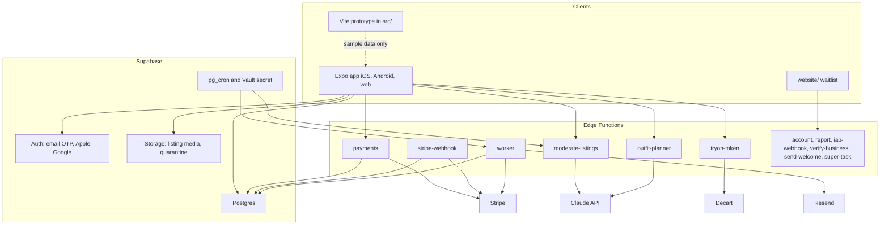
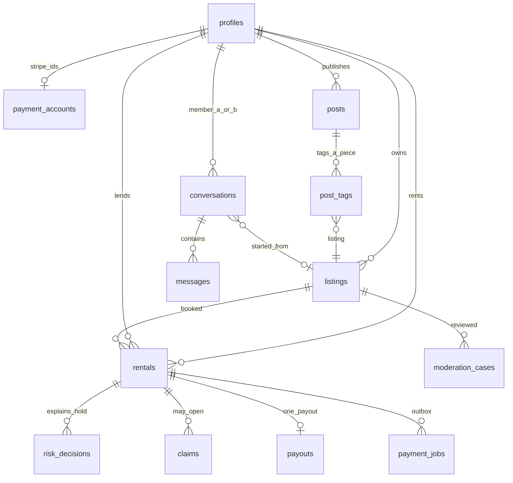
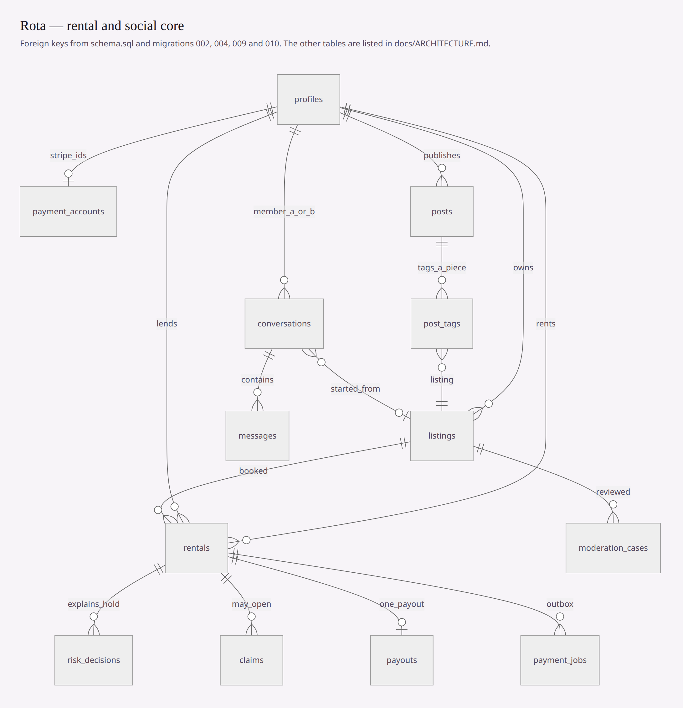

# Architecture

How the code is split, and the tables the migrations actually create. The product overview and the setup commands are in the [README](../README.md).

## Who decides what

| Question | Where it is decided |
|---|---|
| Can these dates be booked? | Postgres exclusion constraint on the listing's dates (`004_payments_and_rental_ops.sql`). A second booking of the same days fails in the database. |
| What is owed, and what is the renter's ceiling? | Snapshot columns on `rentals`: rent, both service fees, shipping, cleaning, `total_charged`, `approved_value`, `max_liability`. `max_liability` cannot exceed `approved_value`. |
| Is a deposit taken? | Default is no. `deposit_required` is turned on only with a `risk_decisions` row. `deposit_amount` must be 0 when no hold is required. |
| When does the lender get paid? | A `payouts` row is unique per rental. It is not released at booking. The database enqueues `payment_jobs.kind = 'transfer_payout'`. `worker` sends that transfer to Stripe with the job's idempotency key. |
| May this listing reach the feed? | `moderate-listings` asks Claude to describe the media. `policy.ts` maps that description to a distribution. The model does not pick `public` / `limited` / `blocked`. |
| May this member open a try-on session? | `tryon_token_allowed` in migration 036, called by `tryon-token` before any Decart token is minted. |
| Who can read a row? | Row level security on every table that members touch. Staff and service-role paths are separate (`is_staff()`, service-role Edge Functions). |

The rates in `policy_config` (service fees, first-rental cap, high-value cap, and the rest) are the numbers the migrations insert. The header of `002_trust_protection.sql` says they are proposed defaults and need counsel review before launch.

## System

## Rental and social core

Foreign keys below are the ones written in `schema.sql` and migrations 002, 004, 009 and 010. Tables that are not on this path are listed after the diagram.

Rendered with Mermaid 11 in headless Chrome on 13 November 2026, from the diagram above.

`payment_accounts` is one row per member and is not readable as part of the public profile. `payouts.rental_id` is unique. `conversations` stores the two members in sorted order so a pair has one thread. `post_tags` is how a photo points at a listing ("rent the look"). `posts.area_lat` / `area_lng` are rounded to a 0.005° grid in `posts_coarsen_area()` before they are stored.

## Edge Functions

All twelve are in `supabase/config.toml` with gateway JWT verification off. Each file's header says how it authenticates.

| Function | Role |
|---|---|
| `payments` | Checkout PaymentIntent, Connect onboarding, Identity session, saved cards. Acts for the signed-in member only. |
| `stripe-webhook` | Payment, Identity, dispute, early-fraud, and `account.updated` events. Two signing secrets. |
| `worker` | Drains `payment_jobs`, sends email and push, purges the 30-day bin. Cron. |
| `moderate-listings` | Queue drain for listing review. Member token or cron. |
| `tryon-token` | Short-lived Decart client token after `tryon_token_allowed`. |
| `outfit-planner` | Picks 2–4 real listing ids for a Rota Pro member. Ids the model invents are dropped. |
| `account` | Export and deletion for the signed-in member. |
| `report` | Public DSA report from the website. Rate limit, no raw IP stored. |
| `iap-webhook` | RevenueCat events. The only writer of Pro and try-on credits. |
| `verify-business` | SIRET lookup against the public French company register. |
| `send-welcome` | One waitlist email per row, from the row id, not from a caller-supplied address. |
| `super-task` | Confirms the waitlist token. The slug is kept because mail already points at it. |

## Tables

`rg -c '^create table'` across `supabase/**/*.sql` reports **56** statements. Names, in the order they appear:

`conversations`, `messages`, `moderation_notices`, `web_reports`, `comment_likes`, `reposts`, `stories`, `story_highlights`, `offers`, `member_entitlements`, `iap_events`, `ai_usage`, `business_details`, `member_mutes`, `member_restricts`, `member_hidden_words`, `storage_orphans`, `tryon_tokens`, `waitlist`, `questions`, `profiles`, `listings`, `favorites`, `policy_config`, `rentals`, `risk_decisions`, `condition_reports`, `possession_codes`, `possession_events`, `payment_consents`, `claims`, `payouts`, `audit_log`, `moderation_cases`, `media_provenance`, `content_reports`, `moderation_appeals`, `staff_members`, `payment_accounts`, `notifications`, `payment_jobs`, `stripe_events`, `member_restrictions`, `safety_incidents`, `member_addresses`, `member_preferences`, `member_blocks`, `challenges`, `posts`, `post_tags`, `follows`, `post_likes`, `post_comments`, `boards`, `board_items`, `social_reports`.

That list is every match of `^create table` in the SQL. It is not a claim that all 56 are applied on a hosted project. Applying them is the manual step in [BACKEND_SETUP.md](BACKEND_SETUP.md).

## What the prototype is

`src/` is a Vite app with its own store (`src/state/store.tsx`) and the sample catalog in `src/data/catalog.ts`. It does not import Supabase or Stripe. Screen captures in [proof/](proof/) come from that app. The Expo screens under `mobile/src/screens/` are the ones that call the backend.
