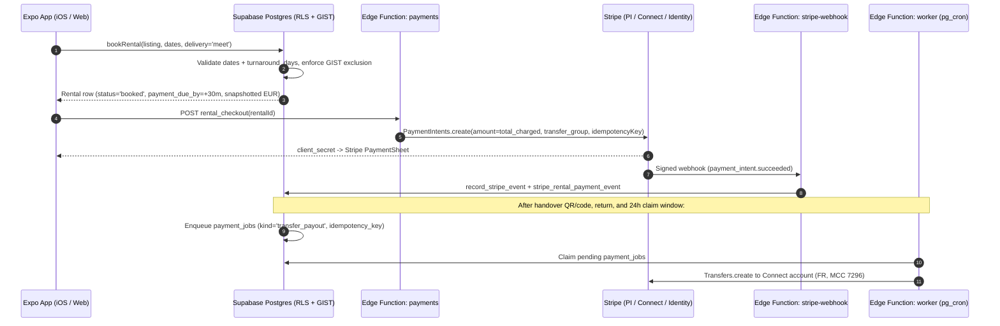
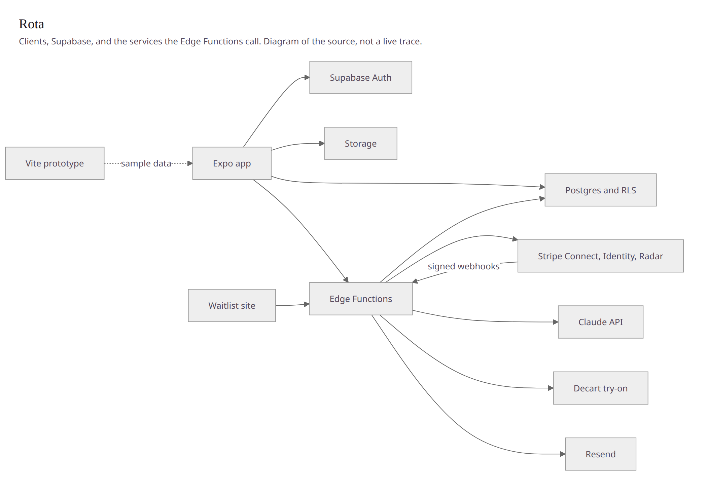
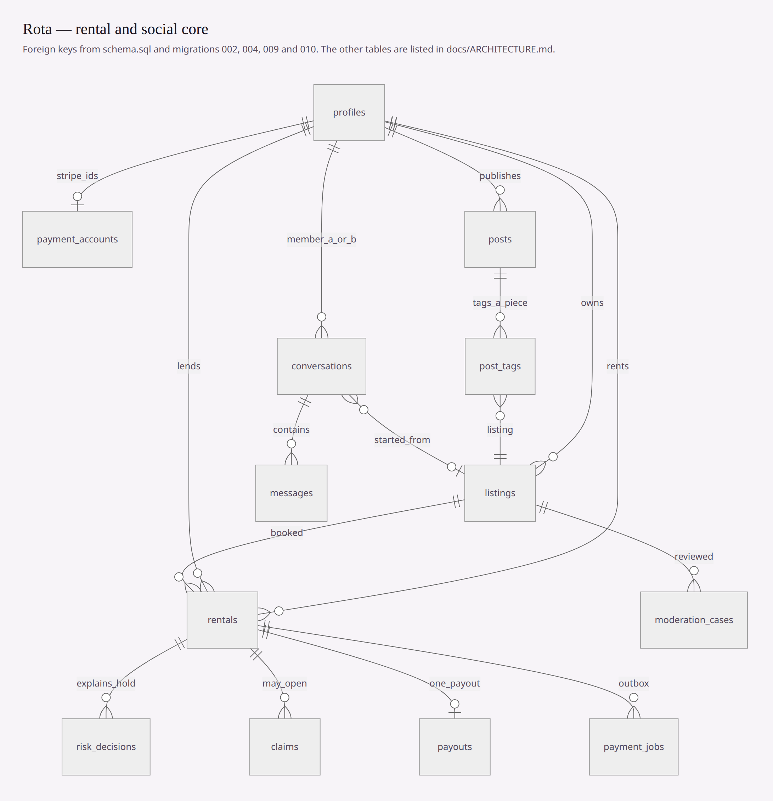
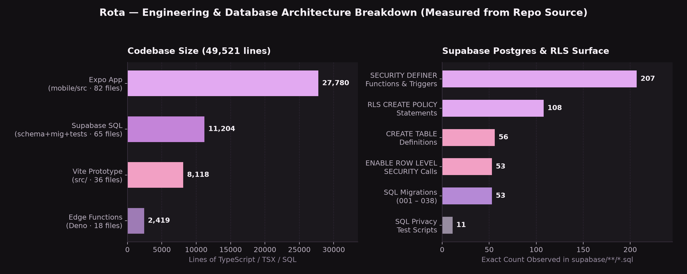

# Engineering Case Study — Rota (`@therotaapp`)

Rota is a Paris-first, peer-to-peer **outfit rental** platform (`therotaapp.com`, `@therotaapp`). A lender lists garments they already own, a renter books dates, they meet in a public Paris location (or later ship via tracked labels), and the lender receives a payout only after confirmed return and expiration of the 24-hour claim window. Feeds, stories, boards, and follows exist exclusively to showcase garments and convert into a rental—never as an open-ended social network.

The repository history on `main` spans **140 commits** from **18 September 2026 to 16 October 2026** (`124` under `Anwarito-lbd`, `16` under `zined`). Every architectural decision documented here is directly enforced in the source code and SQL migrations in this repository. No user counts, GMV, or revenue numbers are claimed, because Rota has not launched publicly.

---

## 1. Core Invariant: "The Phone Is a Client. Postgres Decides."

In a peer-to-peer rental marketplace handling physical garments, deposits, late fees, and damage claims, trusting client-computed totals or client-submitted state transitions is a critical security failure. Rota enforces a strict boundary across **56 tables**, **53 SQL migrations**, **53 `ENABLE ROW LEVEL SECURITY` blocks**, **108 RLS policies**, and **207 `SECURITY DEFINER` routines**:

1. **Price & Liability Snapshots (`002_trust_protection.sql`):**
   - When a rental row is created, Postgres—not the mobile app—calculates and freezes `daily_price`, `renter_service_fee`, `owner_service_fee`, `shipping_fee`, `cleaning_fee`, `total_charged`, `approved_value` (Approved Replacement Value, owned by Rota rather than the lender), and `max_liability` (checked by constraint never to exceed `approved_value`).
   - Blanket security deposits are disabled by default (`deposit_required = false`, `deposit_amount = 0`); a hold is triggered only when a `risk_decisions` row requires one (e.g., high-value garments above `high_value_hold_threshold` or a first-time renter exceeding `first_rental_arv_cap`).
   - All rates and ceilings live in `public.policy_config` (publicly readable for checkout transparency, writable only by `service_role`), never hardcoded in the app bundle.

2. **Database-Level Anti-Double-Booking (`004_payments_and_rental_ops.sql`):**
   - Calendar races cannot happen at the application layer because Postgres enforces mutual exclusion directly using `btree_gist`:
     ```sql
     create extension if not exists btree_gist;

     alter table public.rentals
       add constraint rentals_no_double_booking
       exclude using gist (listing_id with =, blocked_during with &&)
       where (status not in ('cancelled', 'returned', 'closed'));
     ```
   - The `rentals_validate_dates()` trigger builds `blocked_during := daterange(start_date, end_date + 1 + turnaround_days, '[)')`, reserving a 1-day turnaround buffer after return for cleaning/inspection, and assigns `payment_due_by` (`payment_window_minutes = 30`) so unpaid bookings hold dates briefly and expire cleanly.

3. **Outbox Pattern & Idempotent Stripe Execution (`payments`, `stripe-webhook`, `worker`):**
   - When money must move—`transfer_payout`, `charge_claim`, `refund_rental`, holds, or late fees—Postgres writes a row to `payment_jobs` with a deterministic idempotency key.
   - The `worker` Edge Function (invoked via `pg_cron` with a Vault-stored `ROTA_CRON_SECRET`) drains `payment_jobs` and executes Stripe API calls with that idempotency key. A failed or retried cron run cannot double-charge or double-pay.
   - **Stripe Connect & Identity:** Lender onboarding creates `FR` Connect accounts with clothing-rental MCC `7296`, Express-style Stripe-hosted onboarding/dashboard, and `controller: { fees: { payer: 'application' }, losses: { payments: 'application' } }`. `payment_accounts` is isolated from `profiles` via RLS so Stripe customer/account/session IDs never leak to other members. Stripe Identity (government ID + matching selfie) gates both renting and listing (`Verify.tsx`).
   - **Signed Webhooks:** `stripe-webhook` accepts both platform (`STRIPE_WEBHOOK_SECRET`) and connected-account (`STRIPE_CONNECT_WEBHOOK_SECRET`) signatures on a single endpoint, deduplicates deliveries via `record_stripe_event`, updates rental/identity/account state via RPCs, and flags `charge.dispute.created` / `radar.early_fraud_warning.created` to pause payouts.



---

## 2. Design & Client Engineering: Figma → Vite Prototype → Expo Go (iOS)

### Figma Design System & Token Translation
The visual system was redesigned in Figma (`"Rota — iOS redesign" → Tokens`, introduced in commit `5f805df` and codified in `mobile/src/theme/tokens.ts` alongside `design/brand/` and `design/social-screens/00-overview.jpg` – `16-detail-tryon.jpg`):
- **Typography:** Native system font (`SF Pro` on iOS, `Roboto` on Android) for all UI text (`TYPE`: `34 / 28 / 17 / 12 pt`) paired with `Instrument Serif` (`@expo-google-fonts/instrument-serif`) strictly for editorial brand display headlines (*"Wear it once. Pass it on."*).
- **Color & Contrast Discipline:** Dark-first canvas (`#121013` background, `#1B181D` surface, `#251F29` elevated surface) anchored by Rota's lavender hanger hue (`#E2A9F1`). On light theme (`#F8F4FA`), the accent automatically deepens to `#8E3FB0` (`#A83B6E` secondary plum) so pill CTAs and text links retain accessible contrast.
- **Tactile iOS Chrome:** `999` pill radii, `28 pt` bottom sheets, spring animations that honor `AccessibilityInfo.isReduceMotionEnabled`, and a floating **Liquid Glass 4-tab bar** (`mobile/src/ui/TabBar.tsx` using `expo-blur` with a solid fallback when Reduce Transparency is enabled) plus a central `+` camera button.

### Vite Prototype (`src/`) vs. Expo SDK 57 App (`mobile/`)
- **`src/` (Vite `6.4.3` + React `18.3.1`):** Served as a fast, zero-key interactive stage (`36` files, `8,118` lines) with a desktop side-panel switcher across 34 screens and a responsive `@media (max-width: 900px)` phone frame. During verification, copy drift between the prototype and the app/legal drafts (`16+` vs `18+`, insured copy vs no-insurance legal draft) was caught and corrected in `src/`.
- **`mobile/` (Expo SDK `57.0.24` + React Native `0.86.3`):** The production-bound client (`82` files, `27,780` lines across `26` screens) with French-first i18n (`fr`, `en`, `es`), Supabase Auth (Apple, Google, email OTP), Stripe PaymentSheet, and an offline **in-memory demo mode** (`mobile/src/data/demo.ts`) when `mobile/.env` is omitted.
- **iOS Testing via Expo Go & EAS (`docs/TEST_ON_PHONE.md`, `docs/BUILD.md`):** Developed on Windows and tested directly on physical iPhones using **Expo Go** over Wi-Fi / `--tunnel`, while `mobile/metro.config.js` provides web shims (`web-shims/stripe-react-native.tsx`) so `expo start --web` and `expo export --platform web` render full UI previews in Chromium. Native Stripe PaymentSheet, Sign in with Apple, RevenueCat IAP, and native video metadata stripping require EAS builds (`mobile/eas.json` profiles: `development`, `preview`, `production`).

---

## 3. AI Guardrails & Server-Side Budget Enforcement

1. **Listing Moderation (`supabase/functions/moderate-listings/`):**
   - Listings enter `moderation_cases` upon publish. The analyzer runs sequentially: (1) abuse-hash lookup (`hashcheck.ts`, currently stubbed as `not_configured` pending vendor selection), (2) server-extracted video stills via optional Mux, and (3) Claude vision analysis (`npm:@anthropic-ai/sdk`).
   - Crucially, **Claude only describes the media** (garment presence, synthetic likelihood, screenshot detection, text-photo match). Deterministic code in `policy.ts` maps that structured JSON output to `public`, `limited`, or `blocked`, and quarantines unsafe files into the private `moderation-quarantine` bucket. Prompt injection in a listing title cannot grant itself a pass.

2. **Rota Pro Outfit Planner (`supabase/functions/outfit-planner/`):**
   - Gated to Rota Pro subscribers (`is_pro`), rate-limited to `30` calls/day via `bump_ai_usage`, and restricted to picking 2–4 IDs from the real active public listing rows injected into `<catalogue>`. Any hallucinated ID returned by the model is dropped before returning JSON; outputs carry AI-generated disclosure per EU AI Act Art. 50.

3. **Virtual Try-On Budget (`supabase/functions/tryon-token/` & `036_tryon_server_budget.sql`):**
   - `DECART_API_KEY` never ships to the client. Before minting a Decart client token (`npm:@decartai/sdk@0.2`), `tryon-token` verifies the member is authenticated and not suspended, then calls `tryon_token_allowed(p_user)`—which acquires a per-user transaction advisory lock (`pg_advisory_xact_lock`), enforces hourly (`20`/hr) and service-wide daily (`500`/day) ceilings, and only then mints a 10-minute token scoped strictly to `lucy-vton-3.5` and `lucy-image-2` with a 3-minute realtime cap.

---

## 4. Privacy Hardening & Paris-First Handover

- **Public Accounts Without Privacy Leaks (`029`–`034`):** Earlier migration `029` introduced private accounts and follow requests; migration `034_public_accounts.sql` deliberately reverted accounts and stories to public (`check (not is_private)`) because Rota is a rental marketplace where inventory must be discoverable. The safety stack built in `029`–`033` was retained: column-level `profiles` grants (hiding `city`, `identity_status`, `lang`, `deleted_at`, `adult_confirmed_at`), two-way `blocked_between` enforcement across listings/bookings/offers/profiles, mute, restrict, message requests, hidden words, 30-day soft-delete bin (`Récemment supprimé`), full data export, and account closure.
- **Location & Media Hygiene:** Post coordinates are coarsened to a `0.005°` (~550 m) grid in `posts_coarsen_area()` before storage; exact coordinates never persist. Photo uploads strip EXIF metadata client-side (`docs/superpowers/pr-privacy.md`), while residual video metadata in Expo Go is explicitly logged in `docs/legal/02-privacy-outline.md` until EAS dev-client transcoding is added.
- **Paris Handover Default (`docs/DELIVERY.md`):** Checkout defaults to free public meetup (`Rencontre à Paris — Offert`) with curated Paris meeting points in `Messages` (`MEETING_PLACES`). Delivery (`'ship'`) is blocked at the database trigger level while `policy_config.flag_rota_delivery` is `false`.

---

## 5. System & Schema Visuals







---

## 6. Open Pre-Launch Gaps (Stated Explicitly)

- **Legal & Compliance:** `docs/legal/` outlines and `policy_config` defaults require French counsel review (`06-needs-avocat-review.md`, `07-revue-avocat-social-2026-09.md`), and `therotaapp.com/.well-known/` files (`apple-app-site-association`, `assetlinks.json`) must be hosted before Universal Links / App Links go live.
- **External Integrations Pending Credentials/Testing:** Abuse-hash vendor (`CSAM_HASH_PROVIDER`), carrier label API (`flag_rota_delivery`), RevenueCat native SDK (`react-native-purchases`), and live execution of `supabase/tests/privacy/*.sql` against a provisioned Postgres instance.
- **Repository Verification Scope:** All verified checks, TypeScript passes, price-parser assertions, Expo web bundle exports, and `390×844` headless browser captures are recorded verbatim in [docs/PROOF.md](PROOF.md) and [docs/PROOF_OF_WORK.md](PROOF_OF_WORK.md).
